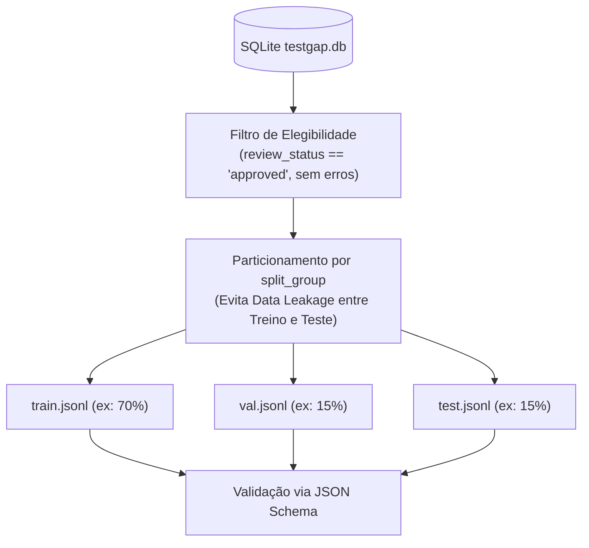

# TestGap Ingestion & Training Export Engine

This skill governs data import, export, partitioning, and schema compliance for **TestGap** (Phase 4 and 6).

---

## 1. Canonical Dataset Specification

The authoritative exchange format is JSON Lines (`.jsonl`), where each line is an independent, valid JSON object following schema version `1.0.0`.

Refer to [jsonl_schema_spec.md](./references/jsonl_schema_spec.md) for the complete JSON Schema definition.

```json
{
  "schema_version": "1.0.0",
  "example_id": "TG-000001",
  "project": {
    "name": "AuthService",
    "language": "python",
    "framework": "pytest"
  },
  "input": {
    "requirements": "Após 5 tentativas falhas, bloquear login.",
    "source_code": "def login(...): ...",
    "test_suite": "def test_login_ok(): ...",
    "test_format": "pytest",
    "analysis_scope": "fluxo_autenticacao"
  },
  "expected_output": {
    "has_gaps": true,
    "gaps": [
      {
        "category": "functional_coverage",
        "title": "Ausência de teste para limite de tentativas",
        "description": "A suíte não testa o bloqueio após 5 tentativas.",
        "requirement_reference": "REQ-005",
        "evidence": "Não há assert para estado de bloqueio.",
        "severity": "high",
        "suggested_test": "Executar 5 chamadas incorretas e checar bloqueio.",
        "expected_result": "Sistema bloqueia novas tentativas."
      }
    ]
  },
  "metadata": {
    "source_type": "human_authored",
    "review_status": "approved",
    "split_group": "auth_service_v1",
    "labels_verified": true
  }
}
```

---

## 2. Training Export & Data Partitioning (Anti-Leakage)

When exporting datasets for AI model fine-tuning or evaluation:



### Eligibility Filters
1. **Status Requirement**: Only export examples with `review_status == 'approved'` (unless running an unreviewed curation dump).
2. **Gap Status Filter**: Exclude any gap marked as `rejected` or `needs_revision`. Only export `confirmed` gaps.
3. **Consistency Check**: If all gaps for an example were rejected, export `has_gaps: false` and `gaps: []`.

### Preventing Data Leakage via `split_group`
- **Rule**: Never split records from the same `split_group` across training and evaluation sets.
- If `auth_service_v1` is assigned to `train.jsonl`, all examples belonging to `auth_service_v1` must remain in `train.jsonl`.
- Evaluation sets (`val.jsonl`, `test.jsonl`) evaluate whether the model generalizes to completely unseen codebases and projects.

---

## 3. Data Ingestion Pipeline (JSONL & CSV)

### JSONL Import Flow
1. **Stream Reading**: Read line-by-line without loading entire multi-gigabyte files into RAM.
2. **Validation**: Validate each record using `CanonicalExample` Pydantic model.
3. **Duplicate Policy**:
   - `skip`: Ignore records whose `content_hash` already exists in SQLite.
   - `overwrite`: Update existing example with imported fields.
   - `error`: Abort if duplicate found.
4. **Transaction Batching**: Insert in batches of 100 within atomic transactions.
5. **Preview & Diagnostics**: Before committing, present a summary table showing:
   - Total rows in file.
   - Valid records ready for insertion.
   - Invalid records with line numbers and validation error details.
   - Duplicate count.

### CSV Import Flow
- Supports tabular imports with standard headers: `title`, `project_name`, `requirements`, `test_suite`, `gap_category`, `gap_description`, `gap_severity`.
- Rows with the same `public_id` or `title` combine into a single example with multiple gaps.

---

## 4. Post-Export Conformance Verification

Every export run must be verified automatically using `scripts/validate_dataset.py`:
- Validates every JSON line against `schemas/dataset-v1.schema.json`.
- Confirms non-empty required strings.
- Confirms valid ISO 8601 dates.
- Checks that line count matches database export query count.
