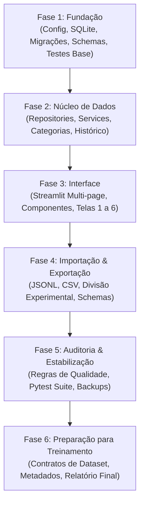

# TestGap Implementation Orchestrator

This skill coordinates the end-to-end development of the **TestGap** platform, ensuring strict compliance with `specs.md` across all six implementation phases, enforcing non-negotiable CLI constraints, and validating acceptance criteria before delivery.

---

## 1. Non-Negotiable Operational Rules

When developing any part of TestGap, the agent must adhere strictly to these rules:

1. **Local Windows Target**: All commands, paths, and environment setups must run natively on Windows 10/11 using PowerShell.
2. **Never Fabricate Execution**: Never invent or simulate test outputs, training metrics, or benchmark results. Run real commands and report actual stdout/stderr.
3. **Strict 4-Layer Separation**:
   - `UI` (Streamlit) -> `Services` (Business logic) -> `Repositories` (SQLite queries) -> `Schemas` (Pydantic models).
   - **No SQL queries are allowed inside Streamlit pages.**
4. **Data Integrity & Non-Destructive Operations**: Never drop or overwrite the SQLite database during normal application startup. Use transactions and migrations.
5. **Human Language Standards**:
   - Technical identifiers, code symbols, filenames, and database columns in **English**.
   - User-facing UI, alerts, labels, and documentation in **Brazilian Portuguese (pt-BR)**.
6. **No External API Dependencies in v0.1**: No paid LLM APIs, cloud syncing, user authentication, or arbitrary code execution engines in v0.1.

---

## 2. Phase-by-Phase Roadmap

Follow the sequential order from Section 19 of `specs.md`. Do not attempt to build everything simultaneously.

### Phase 1: Fundação (Foundation)
- **Goal**: Set up workspace structure, dependencies, configuration, SQLite engine, migrations runner, and initial Pydantic models.
- **Reference Skill**: `testgap-foundation-core`
- **Key Tasks**:
  1. Inspect workspace and preserve existing files.
  2. Create folder structure (`testgap/`, `pages/`, `schemas/`, `data/`, `scripts/`, `tests/`, `docs/`).
  3. Create `requirements.txt`, `requirements-dev.txt`, `pyproject.toml`, `.gitignore`, `.env.example`.
  4. Implement `testgap/config.py` (paths, SQLite path in `data/testgap.db`, log levels).
  5. Implement `testgap/database.py` with foreign keys enabled, WAL mode, transaction helper.
  6. Implement versioned migrations (`schema_migrations` table) and initial schema DDL.
  7. Implement `testgap/enums.py` and `testgap/schemas.py`.
  8. Write initial tests in `tests/test_database.py` and `tests/test_schemas.py`.
- **Exit Gate**: Database initializes cleanly, migrations apply idempotently, and models validate inputs. Pytest passes.

### Phase 2: Núcleo de Dados (Core Repositories & Services)
- **Goal**: Fully functional data access and business layer independent of any UI.
- **Reference Skill**: `testgap-foundation-core`
- **Key Tasks**:
  1. Implement `testgap/repositories/categories.py` and seed the 8 default taxonomy categories.
  2. Implement `testgap/repositories/examples.py` (CRUD, filtering, search, pagination, `content_hash` calculation).
  3. Implement `testgap/repositories/gaps.py` (CRUD, foreign key constraints to examples and categories).
  4. Implement `testgap/repositories/audit.py` (review history, audit log records).
  5. Implement `testgap/services/example_service.py`, `gap_service.py`, `review_service.py`.
  6. Write automated tests in `tests/test_examples.py`, `tests/test_gaps.py`.
- **Exit Gate**: All repository and service operations execute and pass pytest without launching Streamlit.

### Phase 3: Interface Streamlit
- **Goal**: Accessible desktop browser UI with responsive layouts and pt-BR text.
- **Reference Skill**: `testgap-streamlit-ui`
- **Key Tasks**:
  1. Implement `testgap/ui/styles.py` and `testgap/ui/components.py` (badges, metrics cards, code viewers).
  2. Implement `app.py` (Home dashboard, KPI cards, category breakdown, quick links).
  3. Implement `pages/1_Dataset.py` (Paginated grid, multi-filters, actions: view, edit, duplicate draft, delete).
  4. Implement `pages/2_Adicionar_Exemplo.py` (Form sections A to G with client-side validation).
  5. Implement details & inline gap management view.
  6. Implement `pages/3_Categorias.py` (Category management, deactivate unused categories).
  7. Implement `pages/4_Estatisticas.py` (Data distributions, gaps per severity/category, project splits).
  8. Implement `pages/5_Qualidade_Dados.py` (Audit dashboard, trigger audit, view warnings/errors).
  9. Implement `pages/6_Configuracoes.py` (DB path, backup trigger, system status).
- **Exit Gate**: Streamlit server boots up (`streamlit run app.py`), all pages load without unhandled exceptions, and all CRUD actions function through the UI.

### Phase 4: Importação e Exportação
- **Goal**: Reliable JSONL and CSV ingestion, AI dataset export, and split_group division.
- **Reference Skill**: `testgap-import-export`
- **Key Tasks**:
  1. Implement `testgap/utils/jsonl.py`, `testgap/services/export_service.py`, `testgap/services/import_service.py`.
  2. Create JSON Schema `schemas/dataset-v1.schema.json`.
  3. Implement export filtering: approved/reviewed examples, exclusion of rejected gaps.
  4. Implement split partitioning by `split_group` (train / validation / test sets without cross-project leakage).
  5. Implement CSV & JSONL import preview, validation diagnostics, and duplicate handling.
  6. Write tests in `tests/test_import.py` and `tests/test_export.py`.
- **Exit Gate**: Exported JSONL strictly passes JSON Schema validation and import correctly handles invalid/duplicate files.

### Phase 5: Auditoria, Qualidade e Estabilização
- **Goal**: Full automated quality engine, complete test suite, seed data, and documentation.
- **Reference Skill**: `testgap-quality-audit` & `testgap-qa-testing`
- **Key Tasks**:
  1. Implement `testgap/services/quality_service.py` with structural and semantic checks.
  2. Implement CLI scripts: `scripts/init_db.py`, `scripts/seed_demo_data.py`, `scripts/validate_dataset.py`, `scripts/export_dataset.py`, `scripts/backup_database.py`.
  3. Run complete pytest test suite and achieve zero failures.
  4. Author documentation in `README.md` and `docs/*.md`.
- **Exit Gate**: All acceptance criteria from Section 18 of `specs.md` pass.

### Phase 6: Preparação para Treinamento & Entrega Final
- **Goal**: Model input/output contracts, partition metadata verification, and delivery report generation.
- **Key Tasks**:
  1. Verify canonical output contract for AI gap-detection models.
  2. Validate that `split_group` ensures no test leakage.
  3. Generate final delivery report conforming to Section 20 of `specs.md`.

---

## 3. Final Delivery Report Checklist (Section 20)

Before completing the task, the agent must output a comprehensive markdown report containing:

1. **Executive Summary**: Overview of implemented capabilities.
2. **File Tree**: Real directory structure created.
3. **Installation & Run Commands**: Windows PowerShell commands for virtualenv, requirements, DB init, and Streamlit execution.
4. **Local URL**: `http://localhost:8501`.
5. **Real Database Path**: Exact path of `data/testgap.db`.
6. **Test Commands & Real Results**: Exact command (`pytest -v`) and verbatim pass/fail metrics.
7. **Verified Features**: Explicit breakdown of features verified automatically (via pytest) vs. manually.
8. **Exported JSONL Sample**: Real JSON line extracted from exported dataset.
9. **Known Limitations**: Clear disclosure of any non-blocking constraints.
10. **Pending Items / Next Steps**: Recommendations for Phase 6 model training fine-tuning.
