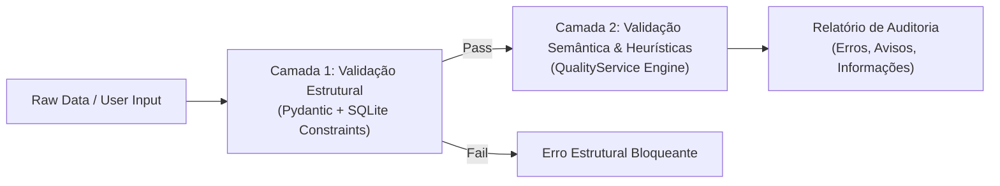

# TestGap Quality Audit & Validation Engine

This skill governs the taxonomy categorization, structural rules, semantic heuristics, and automated quality auditing engine of **TestGap** (Phase 5).

---

## 1. Two-Layer Validation Strategy



### Camada 1: Validação Estrutural (Invariantes Técnicos)
- Enforced at entry time via Pydantic schemas and database constraints.
- Rejects non-conforming data immediately before insertion or update:
  - Required fields cannot be empty or contain only whitespace.
  - All enum fields (`review_status`, `severity`, `status`, `source_type`) must match defined constants.
  - `confidence` must be between `0.0` and `1.0`.
  - Referenced `example_id` and `category_id` must exist.
  - `public_id` must follow `TG-\d{6}` format and be unique.

### Camada 2: Validação Semântica & Heurísticas (Auditoria de Curadoria)
- Executed on-demand via `QualityService.run_full_audit()`.
- Analyzes relationships, consistency, and completeness across the dataset.
- Persists audit summaries into the `audit_results` table.
- **Rule**: Automated audits never modify human-assigned labels silently.

---

## 2. Issue Severity Classification

Every rule violation or heuristic warning produces an `AuditIssue`:

| Gravidade | Impacto | Exemplos |
| :--- | :--- | :--- |
| `error` | **Bloqueia Exportação** | `has_gaps=true` sem nenhuma lacuna confirmada; categoria inexistente ou inativa; JSON corrompido; duplicata exata de conteúdo sem justificativa; lacuna confirmada sem teste sugerido. |
| `warning` | **Atenção Requerida** | Código-fonte ausente; texto de requisitos com menos de 20 caracteres; lacuna sem evidência clara; confiança não preenchida; suspeita de duplicata semântica. |
| `info` | **Observação Não-Bloqueante** | Pouca diversidade de categorias no projeto; exemplo aprovado sem registro de notas de revisão; proporção atípica de severidades. |

---

## 3. Taxonomy Categories Reference

Refer to [taxonomy_guide.md](./references/taxonomy_guide.md) for full descriptions and criteria for all 8 standard categories:
1. `functional_coverage` (Cobertura Funcional)
2. `boundary_values` (Valores-Limite)
3. `security_authorization` (Segurança e Autorização)
4. `integration_state` (Integração e Estado)
5. `test_quality` (Qualidade da Suíte)
6. `performance_reliability` (Desempenho e Confiabilidade)
7. `accessibility_usability` (Acessibilidade e Usabilidade)
8. `other` (Outro)

---

## 4. Quality Rules Specification (`QualityService`)

Implement the following rule checkers in `testgap/services/quality_service.py`:

```python
# Rule Checklist to implement:
# 1. RULE_HAS_GAPS_CONSISTENCY (Severity: ERROR)
#    If example has_gaps == True, must have >= 1 gap with status == 'confirmed'.
#    If example has_gaps == False, must have 0 gaps with status == 'confirmed'.

# 2. RULE_NO_ORPHAN_OR_INACTIVE_CATEGORIES (Severity: ERROR)
#    All gaps must reference an active category.

# 3. RULE_EXACT_DUPLICATE_HASH (Severity: ERROR)
#    Multiple examples sharing the exact same content_hash.

# 4. RULE_MISSING_SUGGESTED_TEST (Severity: ERROR)
#    Confirmed gap without suggested_test or expected_result.

# 5. RULE_MISSING_SOURCE_CODE (Severity: WARNING)
#    Source code is empty; flags that reasoning depends solely on requirements.

# 6. RULE_SHORT_DESCRIPTION (Severity: WARNING)
#    Descriptions shorter than configurable threshold (e.g. < 25 chars).

# 7. RULE_UNCONFIRMED_GAPS_IN_APPROVED (Severity: WARNING)
#    Example marked as 'approved' but contains gaps still marked 'proposed'.

# 8. RULE_SEMANTIC_SIMILARITY_WARNING (Severity: WARNING)
#    Title/requirements high text overlap (>85% Jaccard/Levenshtein) across examples.
```

---

## 5. Audit Reporting Standard

When `QualityService.run_full_audit()` runs:
1. Iterates over all active examples and their gaps.
2. Evaluates all registered quality rules.
3. Groups issues by example and category.
4. Serializes the structured report into JSON.
5. Saves an entry in `audit_results`:
   - `audit_date`: UTC ISO timestamp
   - `audit_type`: `full` or `incremental`
   - `total_examined`: integer count
   - `total_errors`: integer count
   - `total_warnings`: integer count
   - `report_json`: full JSON payload
   - `rules_version`: e.g. `1.0.0`
