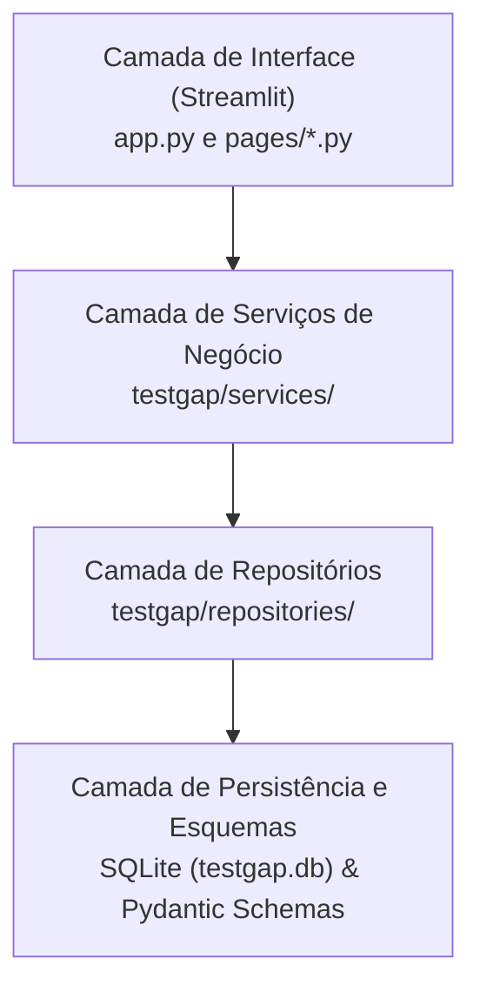

# Arquitetura Técnica do TestGap

## 1. Princípios Arquiteturais

O TestGap foi desenhado para operar como uma aplicação estritamente local no Windows 10/11, com foco em confiabilidade, reprodutibilidade e auditabilidade.

A arquitetura organiza-se em 4 camadas com responsabilidades bem delimitadas:

### Regras de Camada
1. **Interface (Streamlit)**: Não executa consultas SQL e não acessa conexões de banco de dados diretamente. Invoca exclusivamente os métodos dos Serviços.
2. **Serviços**: Coordenam transações, geram hashes criptográficos de conteúdo (`content_hash`), validam regras de negócio multientidade e disparam auditores.
3. **Repositórios**: Executam queries parametrizadas (`?`) e mapeiam registros SQLite para modelos Pydantic ou dicionários tipados.
4. **Esquemas & Persistência**: Definem invariantes através de modelos Pydantic v2 e tabelas com integridade referencial ativa (`PRAGMA foreign_keys = ON;`).

## 2. Persistência e Integridade de Dados
- **Banco**: SQLite com modo de journaling WAL (`PRAGMA journal_mode = WAL;`) e `PRAGMA busy_timeout = 5000;`.
- **Prevenção de Duplicatas**: Hash SHA-256 sobre a concatenação normalizada de `requirements_text | source_code | test_suite_text`.
- **Exclusão Segura**: Foreign keys configuradas com `ON DELETE CASCADE` para remoção automática de lacunas filhas ao excluir um exemplo.
